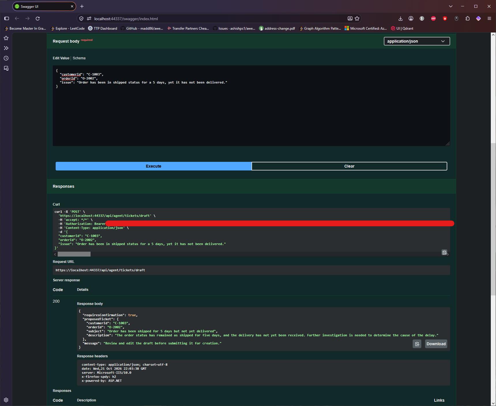
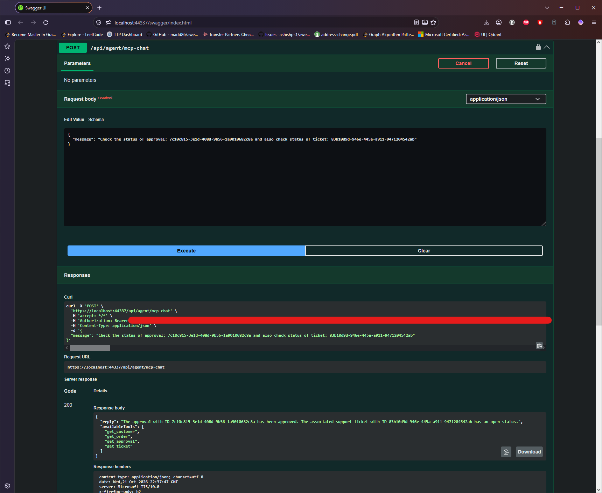
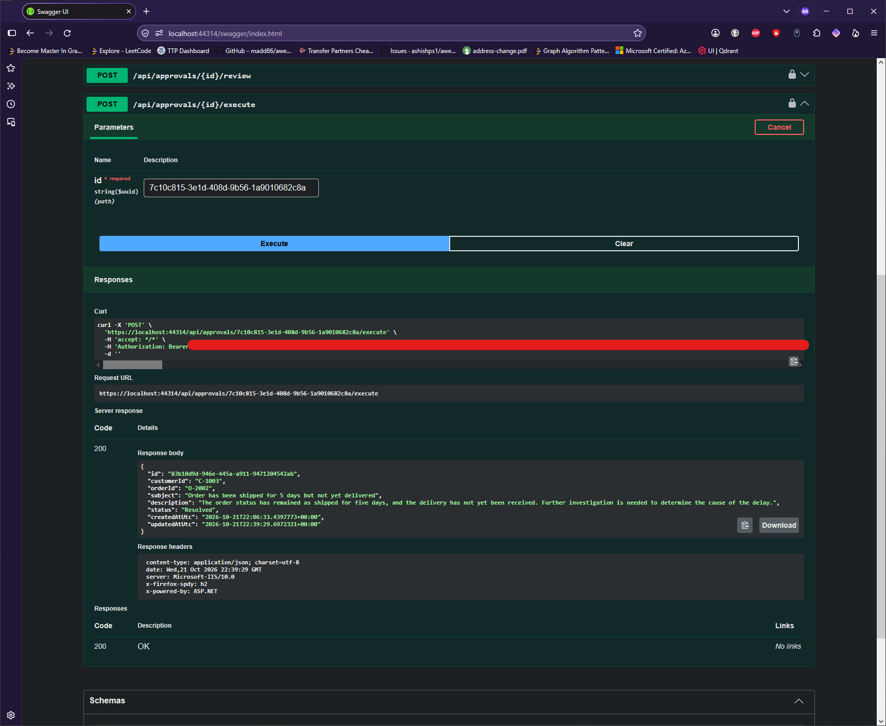
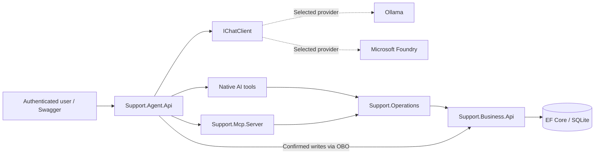

# .NET AI Support Agent

**A model-independent AI support agent built with .NET 10, Microsoft.Extensions.AI, MCP, Microsoft Entra ID, Ollama, and Microsoft Foundry.**

This portfolio project demonstrates how an AI assistant can **read verified business records, draft useful actions, and participate in a support workflow without controlling sensitive approvals or execution**. Native .NET function calling and Model Context Protocol (MCP) tools share reusable operations; the Business API enforces authorization, persistence, and human oversight.

> **Portfolio MVP:** Uses fictional support data and local development infrastructure. It demonstrates architectural and security patterns, not a production-ready customer-support service.

## What it demonstrates

| Capability | Demonstration |
|---|---|
| Model portability | Select local **Ollama** or **Microsoft Foundry** through configuration behind `IChatClient`. |
| Two tool integration paths | Invoke `get_customer`, `get_order`, `get_ticket`, and `get_approval` using native functions or MCP-backed tools. |
| Delegated identity | Microsoft Entra ID scopes and OAuth 2.0 on-behalf-of (OBO) exchanges secure the Agent → MCP → Business API flow. |
| AI-assisted ticket creation | Generate a draft, review it, explicitly confirm, then persist a support ticket. |
| Human-in-the-loop resolution | Draft a resolution proposal, submit it as `Pending`, require an **independent reviewer**, then execute through a separately authorized endpoint. |
| Verified outcomes | The agent retrieves approval and ticket states separately: **Approved does not mean Resolved**. |
| Automated verification | **126 passing tests** at the Step 56 baseline, plus end-to-end development-environment validation. |

## Demo: approval is not execution

The central walkthrough is intentionally more than a chatbot response:

1. The agent retrieves verified customer and order data through read-only tools.
2. The AI drafts a ticket; an authenticated user reviews and confirms creation.
3. The AI drafts a proposed resolution; the user confirms submission.
4. The Business API persists a **Pending** approval request.
5. An **independently authenticated reviewer** approves or rejects the request.
6. Even when the approval is **Approved**, the ticket remains **Open** until separately authorized execution.
7. After execution, the agent uses `get_approval` and `get_ticket` to verify the persisted **Approved / Resolved** outcome.



*AI proposes content; a user decides whether to submit it.*



*The human decision and business execution are separate states.*



*The agent reports the actual persisted result instead of assuming an approved action ran.*

**[Follow the full demonstration →](docs/demo.md)** (steps, endpoints, prerequisites, screenshots, and interviewer talking points). Where a second interactive Entra user is unavailable, independent review is shown through explicitly identified integration-test evidence rather than a simulated live approval.

## Architecture

The solution has a clear separation between AI orchestration, reusable operations, and authoritative business state:



The AI can call **read-only lookup tools**. User-confirmed writes are separate Agent API operations; review and resolution execution are controlled by protected Business API endpoints. Each downstream protected service validates a token issued for its own audience and required scope.

**[Read the architecture documentation →](docs/architecture.md)** for component boundaries, the full Entra ID/OBO sequence, and the human-in-the-loop workflow diagrams.

### Solution layout

```text
src/
  Support.Agent.Api/       # Chat, provider selection, drafts, confirmed submissions
  Support.Business.Api/    # Business rules, authorization, ticket/approval persistence
  Support.Contracts/       # Shared API contracts
  Support.Operations/      # Reusable typed clients and validated lookup operations
  Support.Mcp.Server/      # Protected Streamable HTTP MCP tools
tests/
  Support.Agent.Tests/
  Support.Business.Tests/
  Support.Mcp.Tests/
docs/
  architecture.md
  demo.md
  screenshots/
```

## Technology stack

- **.NET 10 / C#** and ASP.NET Core APIs
- **Microsoft.Extensions.AI (`IChatClient`)** for model-independent chat and function invocation
- **Ollama** (`llama3.2:3b` for local development) and **Microsoft Foundry** (Azure-hosted model deployment)
- **Model Context Protocol (MCP)** with protected Streamable HTTP
- **Microsoft Entra ID**, delegated OAuth scopes, authorization-code + PKCE for the development Swagger client, and OBO between APIs
- **Entity Framework Core 10 + SQLite** for persistent tickets and approvals
- **xUnit**-based integration and unit tests

## Run locally

### Prerequisites

- .NET 10 SDK and Visual Studio with ASP.NET Core development support (the project has been tested using IIS Express profiles)
- An Ollama installation with the configured local model **or** access to a compatible Microsoft Foundry model deployment
- Microsoft Entra app registrations and delegated permissions for the development client, Agent API, MCP server, and Business API
- Appropriate Azure credentials and inference permissions when selecting Foundry

### Configuration

Each API uses an ignored `appsettings.Development.json` file for machine-specific configuration. **Do not commit client secrets, access tokens, or local development settings.** Confidential application credentials use **.NET User Secrets**; Foundry inference uses `DefaultAzureCredential`.

Configure the services according to the [architecture documentation](docs/architecture.md) and existing application settings:

| Project | Local configuration |
|---|---|
| `Support.Agent.Api` | Entra tenant/app settings, Business API HTTPS URL, MCP URL, existing Ollama endpoint/model, `AI:Provider`, and optional Foundry endpoint/deployment |
| `Support.Mcp.Server` | Entra tenant/app settings and Business API HTTPS URL |
| `Support.Business.Api` | Entra tenant/app settings, local database connection, and Swagger OAuth configuration |

For provider selection, retain your existing Ollama configuration and set:

```json
"AI": {
  "Provider": "Ollama"
}
```

Or select Foundry and configure its deployment:

```json
"AI": {
  "Provider": "Foundry"
},
"Foundry": {
  "Endpoint": "https://YOUR-RESOURCE.openai.azure.com/",
  "Deployment": "YOUR-DEPLOYMENT-NAME"
}
```

These JSON fragments belong **inside** the existing configuration object; they are not replacement files. The Foundry endpoint must match the Azure OpenAI-compatible endpoint expected by the application's `AzureOpenAIClient` registration. A Foundry project administration URL is not interchangeable with it.

### Build and test

From the solution root:

```bash
dotnet restore
dotnet build
dotnet test
```

Start **Business API**, **MCP server**, and **Agent API** using their configured development profiles. Start Ollama as well when `AI:Provider` is `Ollama`. The MCP endpoint is configured at `http://localhost:5105/mcp`; the Business and Agent API HTTPS ports depend on their local profiles. Authenticate in Swagger before invoking protected endpoints.

For a guided workflow with example requests, use **[docs/demo.md](docs/demo.md)**. Azure tenant/app registration, consent, and role assignments are external prerequisites; cloning the repository alone does not provision them.

## Security and human oversight

- Agent API access requires `Agent.Invoke`; protected MCP calls use `Mcp.Invoke`.
- Read-only Business API access uses `Support.Read`; confirmed ticket creation uses `Tickets.Create`; proposal submission uses `Tickets.Approval.Request`.
- Human review requires `Tickets.Approval.Review` and rejects requester self-review.
- Execution requires `Tickets.Resolve` and a persisted approved review decision.
- The model is **not** given approve, reject, execute, or confirmed-write tools.
- A failed lookup is not interpreted as a missing record; MCP tool execution is allowlisted, bounded, and sanitizes errors.

Model prompts guide responses, but **Business API authorization and persisted workflow state** enforce the security boundary.

## Verification

At the completion of model-provider integration, the solution had **126 passing automated tests**. Coverage includes authentication policies, ticket/approval persistence, review and execution rules, lookup behavior, MCP error handling and budgets, AI draft parsing, and provider configuration. Manual checks also verified Ollama and Foundry using both native and MCP-backed agent tools.

The demo evidence is in [`docs/demo.md`](docs/demo.md) and [`docs/screenshots/`](docs/screenshots/). Screenshots use fictional support data and should be checked for sensitive content before sharing.

## Design choices and limitations

The solution favors **observable, interview-ready behaviors** over unnecessary infrastructure. It intentionally omits production-grade multitenant or record-level access control, comprehensive concurrency guarantees, durable confirmation tokens, full operations monitoring, and deployment automation. Swagger is the current demonstration interface, not a polished end-user UI.

**RAG is intentionally out of scope.** Knowledge retrieval is explored in a separate portfolio project; this one focuses on **secure AI agents, reusable tools, MCP, delegated identity, and human-controlled business actions**.

For deeper discussion, see [architecture and tradeoffs](docs/architecture.md) or [the end-to-end demo](docs/demo.md).
