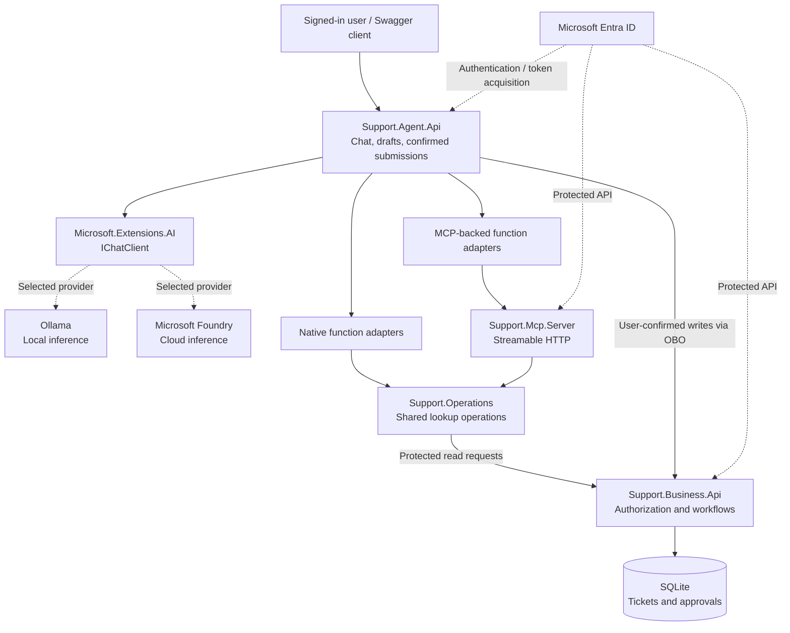
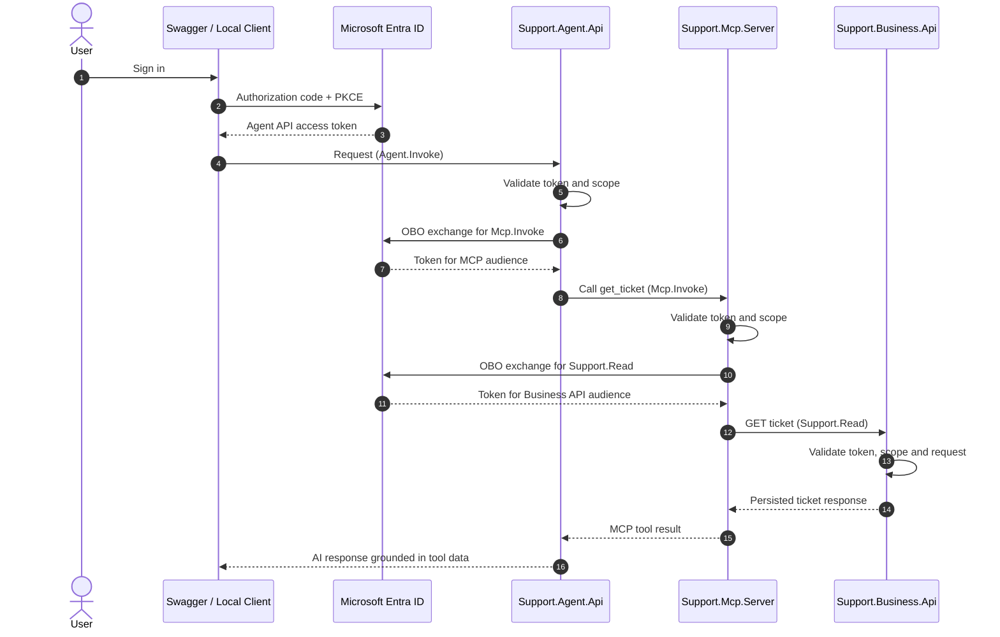
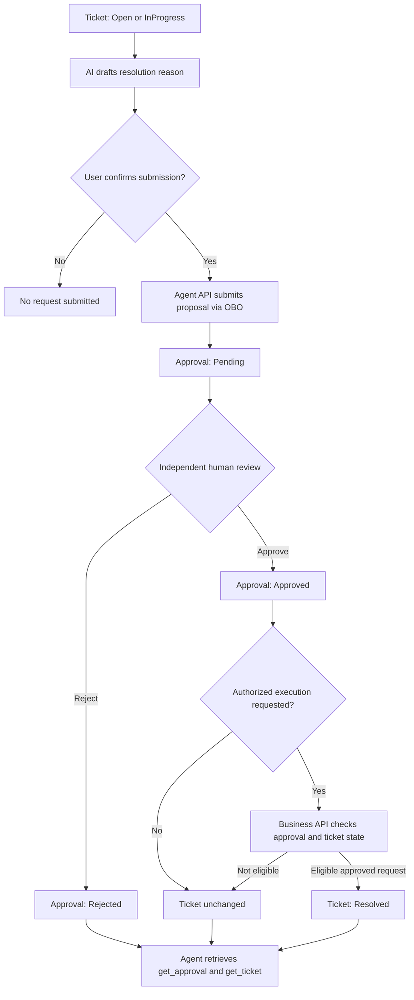

# .NET AI Support Agent — Architecture

## Overview

The **.NET AI Support Agent** is a .NET 10 portfolio application demonstrating secure AI tool calling, Model Context Protocol (MCP) interoperability, delegated identity, and human-controlled business workflows.

The application supports two configurable model providers—**local Ollama** and **Microsoft Foundry**—through `Microsoft.Extensions.AI.IChatClient`. It uses native .NET AI functions or MCP-backed tools to retrieve fictional customer, order, ticket, and approval information. State-changing operations use separate, authenticated HTTP endpoints rather than unrestricted model-executable tools.

**Scope:** This is a portfolio MVP using fictional support data, not a production customer-support platform. Enterprise RAG is deliberately outside this project's scope.

## Solution structure

```text
DotNetAiAgent/
├── src/
│   ├── Support.Agent.Api/       # AI chat, drafts, confirmation endpoints, provider selection
│   ├── Support.Business.Api/    # Business endpoints, authorization, EF Core persistence
│   ├── Support.Contracts/       # Shared request and response DTOs
│   ├── Support.Operations/      # Reusable validated lookup tools and typed HTTP clients
│   └── Support.Mcp.Server/      # Protected MCP tools over Streamable HTTP
├── tests/
│   ├── Support.Agent.Tests/
│   ├── Support.Business.Tests/
│   └── Support.Mcp.Tests/
└── docs/
    └── architecture.md
```

## System architecture



**Reading the diagram:** Ollama and Foundry are **alternative** providers selected by configuration, not simultaneous inference requirements. Native and MCP-backed chat paths share `Support.Operations`; the MCP server is a separate protected hop. The Agent API also calls the Business API directly for user-confirmed write requests. Only the Business API accesses the SQLite database.

### Component responsibilities

| Component | Responsibility |
|---|---|
| `Support.Agent.Api` | Authenticated AI chat; Ollama/Foundry selection; native/MCP function integration; AI-assisted ticket and resolution drafts; user-confirmed submissions. |
| `Support.Mcp.Server` | Exposes allowlisted, read-only support lookup tools through protected MCP Streamable HTTP. |
| `Support.Operations` | Houses reusable validated customer, order, ticket, and approval lookups and typed Business API HTTP clients. |
| `Support.Business.Api` | Owns fictional customer/order records, ticket and approval endpoints, authorization policies, business rules, and database access. |
| `Support.Contracts` | Shared API request and response contracts. |
| SQLite / EF Core | Persists tickets and approval requests, including approval and ticket states. |
| Microsoft Entra ID | Authenticates callers and issues audience-specific delegated tokens for protected APIs. |
| Ollama / Microsoft Foundry | Provides language-model inference behind `IChatClient`. |

The AI's callable tools are **read-only**: `get_customer`, `get_order`, `get_ticket`, and `get_approval`. They do not expose ticket creation, approval decisions, or ticket-resolution execution to the model. The MCP service also has a `server_info` tool, which is not in the agent's allowlist.

## Authentication and delegated identity

The application uses **Microsoft Entra ID**, OAuth 2.0 authorization code with PKCE for the development Swagger client, and the **on-behalf-of (OBO)** flow for delegated downstream API access. Each API validates access tokens for its own audience and required scope.

### MCP-backed lookup sequence



For **native tool calling**, the Agent API gets a `Support.Read` token via OBO and contacts the Business API directly; it does not route native requests through the MCP server. For **MCP tool calling**, OBO happens twice: Agent API → MCP server (`Mcp.Invoke`) and MCP server → Business API (`Support.Read`). The original Agent API token is not reused across incompatible audiences.

### Authorization boundaries

| Operation | Delegated scope | Enforced by |
|---|---|---|
| Invoke Agent API endpoints | `Agent.Invoke` | Agent API |
| Invoke MCP service | `Mcp.Invoke` | MCP server |
| Read customer, order, ticket and approval data | `Support.Read` | Business API |
| Create support ticket | `Tickets.Create` | Business API |
| Submit a resolution approval request | `Tickets.Approval.Request` | Business API |
| Review an approval request | `Tickets.Approval.Review` | Business API |
| Execute an approved ticket resolution | `Tickets.Resolve` | Business API |

The Agent API uses delegated OBO tokens to submit **user-confirmed** ticket creation and resolution proposals. It is **not** granted `Tickets.Approval.Review` or `Tickets.Resolve` for its AI workflows. The Business API records the requester's user object ID and rejects self-review of a proposal.

**Boundary note:** A delegated scope is not, by itself, full employee-level role governance or record-level authorization. The current project demonstrates permission checks and requester/reviewer separation with fictional data, not a production entitlements model.

## Human-in-the-loop ticket resolution

The application deliberately separates **AI suggestion**, **user confirmation**, **human review**, and **authorized execution**. An `Approved` resolution request does not automatically mean its ticket has been resolved.



### Responsibilities and safeguards

1. The AI produces a **draft** ticket or resolution reason without write-capable tools.
2. The signed-in user reviews the draft and explicitly confirms submission through an Agent API endpoint.
3. The Agent API requests the appropriate downstream delegated scope via OBO.
4. The Business API creates a `Pending` approval request and records the authenticated requester identity.
5. A separate authorized reviewer may approve or reject. The Business API prevents the original requester from reviewing their own request.
6. The approved action is applied only through a separately protected execution endpoint, which checks the persisted approval and current ticket state.
7. The agent can read `get_approval` and `get_ticket` to distinguish human decision from completed execution.

For example, approval **`Approved`** plus ticket **`Open`** means authorization was granted but resolution has **not been observed**. The agent must not report `Resolved` unless a fresh ticket lookup confirms it.

## Key architectural decisions

### Model-independent AI integration

The application uses `Microsoft.Extensions.AI.IChatClient` and a configuration-selected provider: local Ollama or Microsoft Foundry. This keeps tool and workflow logic independent of model inference. Foundry access uses Azure identity credentials rather than committed inference API keys.

### One set of business-facing operations

`Support.Operations` is used by both native AI function adapters and MCP tool adapters. Business API HTTP clients handle retrieval; the AI tool layer does not own customer data or EF Core entities.

### Business API as authority

`Support.Business.Api` owns state, business constraints, and authorization. Neither LLM output nor a tool description grants permission to create, approve, or execute actions.

### Deliberately read-only AI tools

The model can look up customer, order, ticket, and approval records. It cannot invoke approval/rejection, ticket-resolution execution, or the explicitly confirmed write endpoints as an automatic AI tool.

### Persisted and reviewable state

EF Core and SQLite provide durable ticket and approval records for a local demonstration. Approval decisions and ticket statuses are stored separately, making their distinction verifiable.

### Lightweight reliability protections

The MCP-backed agent allowlists its available tools, caches successful read-only lookups within a chat request, limits downstream MCP calls per request, and sanitizes tool failures. A failed lookup is not silently converted into `found: false`.

### Portfolio scope and limitations

This is intentionally **not production-ready**. Areas deferred include comprehensive per-customer/tenant authorization, stronger concurrency and idempotency guarantees, operational monitoring, production deployment automation, durable preview/confirmation tokens, and enterprise-scale review governance. These choices keep the project focused on tool orchestration, OBO, MCP, and human-controlled state transitions.

**RAG is intentionally omitted.** Enterprise retrieval architecture is covered by a separate portfolio project; this application focuses on agent workflows.

## Testing and verification

The solution currently has **126 passing automated tests** across Agent, Business, and MCP test projects. They cover authentication policies, lookup behaviors, ticket persistence, approval decisions, authorized resolution, model draft parsing, MCP tool-result handling, caching/budgets, and AI provider configuration.

Manual integration testing has verified:

- Ollama-based and Foundry-based native tool calling.
- Ollama-based and Foundry-based MCP-backed tool calling.
- Delegated authentication across Agent API, MCP server, and Business API.
- Ticket drafting, explicit confirmation, persistence, and lookup.
- Resolution proposal drafting and submission.
- Independent approve/reject behavior and approval-gated execution.
- Correct reporting when an approval is `Approved` but its ticket is still `Open`, and after it becomes `Resolved`.

Automated tests do not require live Ollama, Azure model inference, or real Entra sign-ins; those integrations are validated separately.

## Local development notes

- Start the **Business API** using its configured HTTPS launch profile; it owns the local SQLite database.
- The **MCP server** exposes protected Streamable HTTP at `/mcp` and a health endpoint at `/health`.
- Start the **Agent API** using its configured HTTPS launch profile and authorize via Swagger as required.
- Choose `AI:Provider` = `Ollama` or `Foundry` in ignored development configuration.
- Keep Entra confidential client secrets in **.NET User Secrets**; do not commit secrets, bearer tokens, or SQLite database files.
- For model inference, Foundry uses local Azure credentials (`DefaultAzureCredential`) with suitable resource access; this is separate from application OBO access tokens.

See the repository root [README](../README.md) for project setup and demonstration instructions.
